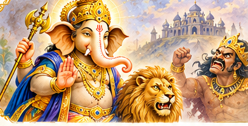
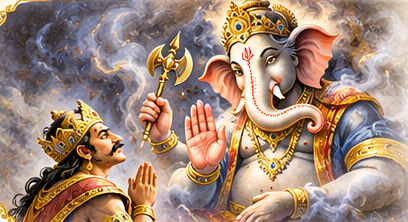
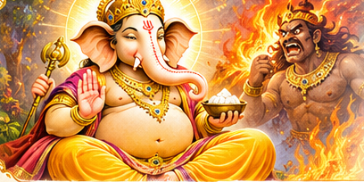
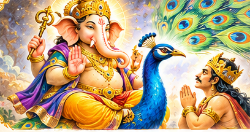

# పురాణ కథలు — మన అంతరంగానికి అద్దాలు

### జ్ఞానోదయం | శ్రీ గణేశ తత్త్వం

**నేటి పాఠకుల కోసం సరళమైన కథనం, ఆధ్యాత్మిక అంతరార్థం, ఆత్మపరిశీలన**

పురాణ కథల్లో కనిపించే అసురులు మనలోని కొన్ని ప్రవృత్తులను కూడా గుర్తుచేస్తారు. అసూయ, అహంకారం, కోపం, కోరిక — ఇవి మనలో ఎలా మొదలవుతాయి? ఎరుకతో వాటిని ఎలా గమనించవచ్చు? ఈ నాలుగు కథలను చదువుతూ ఆ ప్రశ్నలను మనలో పరిశీలించుకుందాం.

ఈ కథనాలు QLU జ్ఞానోదయం ప్రసంగాల అందుబాటులో ఉన్న క్యాప్షన్ల ఆధారంగా సులభమైన తెలుగులో సంపాదించబడ్డాయి. కథల్లోని ప్రతీకలు, బోధనలు ప్రసంగాల భావాన్ని అనుసరిస్తాయి; చివర్లోని **ఆలోచించండి** ప్రశ్నలు పాఠకుల ఆత్మపరిశీలన కోసం సంపాదకీయంగా చేర్చబడ్డాయి.

---

## 1. వక్రతుండుడు — మత్సరాసురుడు
**అసూయను గుర్తించి, మనసును విశాలం చేసుకోవడం**

**జ్ఞానోదయం 531వ రోజు | హారిక సూరి**  
**వీడియో:** https://www.youtube.com/watch?v=5f37J9rtITg

### కథ

పురాణంలో మత్సరాసురుడు అనే అసురుడు ఉంటాడు. ‘మత్సరం’ అంటే అసూయ. తనకన్నా మరొకరు గొప్పగా ఉండటం అతనికి నచ్చదు. అతనిలోని ఈ భావం పెరిగి, అధికారం సంపాదించాలనే తపనగా మారుతుంది. చివరకు దేవతలకే ఇబ్బందులు కలిగించే స్థాయికి చేరుకుంటాడు.

దేవతలు గణేశుని ఆశ్రయిస్తారు. అప్పుడు గణేశుడు **వక్రతుండుడు** అనే రూపంలో, సింహవాహనంపై వస్తాడు. మత్సరాసురుడు ఒక ప్రశ్న అడుగుతాడు: దేవతలూ, అసురులూ ఒకే సృష్టిలో భాగమైనప్పుడు గణేశుడు దేవతల పక్షాన ఎందుకు నిలుస్తున్నాడు?

దానికి ప్రసంగంలో వివరించిన భావం ఇది: ఒకరి పక్షం పట్టడం కాదు; **అధర్మం పెరిగినప్పుడు ధర్మాన్ని నిలబెట్టడం** ముఖ్యం. వక్రతుండుని దివ్యరూపం చూసిన మత్సరాసురుడు తన తప్పును గుర్తించి క్షమాపణ కోరుతాడు.

### కథ ఎలా ముందుకు సాగింది

ఈ కథకు ముందుగా దక్షుడు–ముద్గల మహర్షి సంభాషణ నేపథ్యాన్ని ప్రసంగంలో వివరిస్తారు. మత్సరాసురుని పెరుగుదల, బంధువుల ప్రోత్సాహం, ముల్లోకాలపై అతని ఆధిపత్యం వంటి ఘటనలు తరువాత వస్తాయి. దేవతలు గణేశుని ఆశ్రయించినప్పుడు ఆయన **సింహవాహనంపై, సిద్ధి–బుద్ధులతో కలిసి వక్రతుండ రూపంలో** ప్రత్యక్షమవుతాడు.

యుద్ధంలో **ప్రమోద, ఆమోద, బ్రహ్మప్రియ**, తరువాత **సర్వగ, సర్వవిత్** వంటి గణాల ప్రస్తావన వస్తుంది. మత్సరాసురుని రాజధాని పేరు **ఈర్ష**. యుద్ధం కొనసాగిన తరువాత మత్సరాసురుడు ఒక ప్రశ్న అడుగుతాడు: దేవతలు, అసురులు ఇద్దరూ ఒకే సృష్టిలో భాగమైనప్పుడు గణేశుడు దేవతల వైపు ఎందుకు నిలబడ్డాడు? గణేశుడు పక్షపాతం గురించి కాకుండా **అధర్మం అధికమై సృష్టిలో అసమతుల్యత ఏర్పడినప్పుడు సమతుల్యతను నిలబెట్టడం** గురించి వివరిస్తాడు. ఆ తరువాత మత్సరాసురుడు తన తప్పును గ్రహించి ప్రార్థించి శరణాగతి పొందుతాడు.

### కథలోని లోతైన అర్థం

మత్సరాసురుడు మనకు పూర్తిగా తెలియని వ్యక్తి కాదు. ఇతరుల విజయాన్ని చూసి మనలో అసూయ కలిగినప్పుడు అదే ప్రవృత్తిని మనం కూడా గమనించవచ్చు.

ప్రసంగంలో వక్రతుండుని రూపం ద్వారా **ఆలోచనల్లో సరళత, మన లోపాలను అంగీకరించడం** గురించి వివరిస్తారు. ‘నేను అనుకున్నదే సరైన మార్గం’ అని పట్టుబట్టకుండా, ఇతరుల మార్గాలనూ గౌరవించాలి. ఆయన సింహవాహనం మనలోని అసూయను ఎదుర్కొనే ధైర్యానికి సూచికగా వివరించబడింది.

మనలో అసూయ కనిపించిందని బాధపడటం కంటే, దానిని గుర్తించి, మంచి గుణాలను పెంచుకోవడం ముఖ్యం. ధ్యానం, స్వాధ్యాయం ఈ మార్పుకు సహాయపడతాయి.

**ఆలోచించండి:** మరొకరి ఎదుగుదల చూసినప్పుడు నాకు ఆనందమా, అసూయా? నా ఆలోచనను మార్చుకోవడానికి నేను సిద్ధంగా ఉన్నానా?

---

---

## 2. ధూమ్రవర్ణుడు — అహంకాసురుడు
**‘నేనే గొప్ప’ అనే భావం నుంచి వినయం వైపు**

**జ్ఞానోదయం 536వ రోజు | బి. భానుమూర్తి**  
**వీడియో:** https://www.youtube.com/watch?v=OEkg_03tI_0

### కథ

పురాణ కథనం ప్రకారం సూర్యదేవునిలో ఒక సందర్భంలో అహంకార భావం కలుగుతుంది. దాని నుంచి **అహంకాసురుడు** జన్మిస్తాడు. అతని పేరులోనే అతని స్వభావం ఉంది: అహంకారం.

అహంకాసురుడు శుక్రాచార్యుని మార్గదర్శకత్వంలో గణేశుని ఆరాధించి వరాలను పొందుతాడు. తరువాత **విషయప్రియ** అనే నగరాన్ని ఏర్పాటు చేసుకుంటాడు. **మమత**తో అతని వివాహం జరుగుతుంది; **గర్వం**, **శ్రేష్ఠం** అనే పేర్లు కూడా కుటుంబ కథలో వస్తాయి. ఈ పేర్లన్నీ మనలోని భావాలను గుర్తుచేస్తాయి.

వరబలం పెరిగేకొద్దీ అహంకాసురుని అధికార దాహం కూడా పెరుగుతుంది. మూడు లోకాలపై ఆధిపత్యం సాధించాలనుకుంటాడు. అతని పక్కన **అధర్మ ప్రచారకుడు** అనే మంత్రి ఉండి అహంకారాన్ని మరింత ప్రోత్సహిస్తాడు.

చివరకు గణేశుడు **ధూమ్రవర్ణుడు** అనే అవతారం తీసుకుంటాడు. అహంకాసురుడు తన శక్తికి పరిమితి ఉందని గ్రహించే పరిస్థితి వస్తుంది. అతని గర్వం తగ్గి, గణేశుని ఆశ్రయించే దిశగా కథ సాగుతుంది.

### కథలోని ముఖ్యమైన మలుపు

అహంకాసురుని అణచేందుకు ధూమ్రవర్ణుడు ప్రత్యక్షమైన తరువాత **నారదుని ద్వారా సంధి సందేశం** పంపుతాడు. ముందుగా వచ్చిన హెచ్చరికను అహంకాసురుడు అంగీకరించడు. యుద్ధం జరుగుతుంది. ధూమ్రవర్ణుని భయంకరమైన ధూమరూపాన్ని, అహంకాసురుని కుమారులు గర్వం–శ్రేష్ఠం సంహరించబడటాన్ని ప్రసంగం వివరిస్తుంది. అప్పుడు అహంకాసురుడు **శుక్రాచార్యుని** ఆశ్రయిస్తాడు. గురువు అతనికి గణేశుని ముందు అహంకారాన్ని విడిచి శరణాగతి కోరమని సూచిస్తాడు. ఈ సందర్భంలో **సిద్ధి–బుద్ధి** శక్తుల గురించి కూడా వివరణ వస్తుంది. చివరకు అహంకాసురుడు క్షమాపణ కోరుతాడు.

### కథలోని లోతైన అర్థం

మనం ఏదైనా సాధించినప్పుడు సంతోషించడం సహజం. కానీ ‘ఇదంతా నా వల్లే జరిగింది; నాకు ఎవరి అవసరమూ లేదు’ అనే భావం పెరిగితే అది అహంకారంగా మారుతుంది.

అహంకాసురుని చుట్టూ ఉన్న పేర్లను గమనించండి: **విషయప్రియ, మమత, గర్వం, అధర్మ ప్రచారకుడు**. అహంకారం ఒక్కటే ఉండదు; దానికి తోడుగా మరికొన్ని ప్రవృత్తులు బలపడవచ్చని కథ సూచిస్తుంది.

ఈ కథ మనల్ని మనం ఒక ప్రశ్న అడగమంటుంది: **‘నేను ఎవరు?’** పదవి, పేరు, సంపద, విజయాలకు అతీతంగా మనల్ని మనం తెలుసుకునే ప్రయాణంలో ధ్యానం, స్వాధ్యాయం ఉపయోగపడతాయి.

**ఆలోచించండి:** నా విజయాలు నాలో కృతజ్ఞతను పెంచుతున్నాయా, గర్వాన్ని పెంచుతున్నాయా? నన్ను ఎవరైనా సరిదిద్దినప్పుడు వినగలుగుతున్నానా?

---

---

## 3. లంబోదరుడు — క్రోధాసురుడు
**కోపం వచ్చినప్పుడు మనలో ఏమి జరుగుతోంది?**

**జ్ఞానోదయం 537వ రోజు | హారిక సూరి**  
**వీడియో:** https://www.youtube.com/watch?v=3jzOkJZMA1A

### కథ

లంబోదర అవతారంలో ప్రధానంగా కనిపించే అసురుడు **క్రోధాసురుడు**. ‘క్రోధం’ అంటే కోపం. కథలో ఈ ప్రవృత్తి బలపడుతూ ఇతరులకు హాని కలిగించే స్థాయికి చేరుతుంది.

క్రోధాసురుని శక్తి, ఆవేశం పెరిగినప్పుడు గణేశుడు **లంబోదరుడు** అనే రూపంలో అతన్ని ఎదుర్కొంటాడు. లంబోదరుని మహత్తర స్వరూపం ముందు క్రోధం యొక్క పరిమితి బయటపడుతుంది. ఈ కథను వివరిస్తూ ప్రసంగంలో కోపం, స్వార్థ సంకల్పం, అంగీకారం, సత్యదర్శనం వంటి అంశాలను పరిశీలించారు.

### కథకు నేపథ్యం

ప్రసంగంలో **విష్ణువు మోహినీ రూపం** చూసిన తరువాత శివునిలో కలిగిన కోపం నుంచి క్రోధాసురుడు పుట్టిన కథను చెబుతారు. క్రోధాసురుడు **శుక్రాచార్యుని** మార్గదర్శకత్వంలో **సూర్యుని** ఆరాధించి వరాలు పొందుతాడు. తరువాత తన అధికారాన్ని విస్తరించి **ఆవేశం** అనే రాజధానిని స్థాపిస్తాడు.

అతడు **ప్రీతి**ని వివాహం చేసుకుంటాడు. వారి పిల్లలు **హర్షం, శోకం**. ఈ పేర్ల వెనుక ఉన్న అంతరార్థాన్ని ప్రసంగం విశదీకరిస్తుంది: మనకు ప్రీతిగా ఉన్నది మన కోరిక మేరకు జరిగితే హర్షం, జరగకపోతే శోకం; ఈ బంధం నుంచి క్రోధం పెరుగుతుంది. దేవతలు ప్రార్థించినప్పుడు **లంబోదరుడు** ప్రత్యక్షమై వారికి ధైర్యమిచ్చి తమ ధర్మాన్ని నిర్వర్తించమని సూచిస్తాడు. తరువాతి సంఘర్షణను ప్రసంగం మనలో కోపం పరాకాష్ఠకు చేరే స్థితితో పోలుస్తుంది.

### కథలోని లోతైన అర్థం

మనకు కోపం వచ్చినప్పుడు ఎదుటివారి తప్పే ఎక్కువగా కనిపిస్తుంది. వారు గతంలో చేసిన మంచి పనులు కూడా ఆ క్షణంలో గుర్తుకు రాకపోవచ్చు.

కోపం వెనుక కొన్నిసార్లు **‘నేను కోరుకున్నట్లే జరగాలి’** అనే పట్టుదల ఉంటుంది. ఆ పట్టుదలను గుర్తించకుండా బయట పరిస్థితిని మాత్రమే మార్చాలని ప్రయత్నిస్తే మనసు మరింత అశాంతికి లోనవుతుంది.

లంబోదరుని కథలోని బోధన మన భావాలను తెలుసుకునే దిశగా నడిపిస్తుంది. ధ్యానం అంటే కేవలం కూర్చున్నప్పుడు ప్రశాంతంగా ఉండటం కాదు; రోజువారీ పనుల్లో కూడా **ఎరుకతో స్పందించడం** నేర్చుకోవడం.

**ఆలోచించండి:** నాకు కోపం వచ్చినప్పుడు దాని వెనుక ఏ ఆశ ఉంది? కోపంలో ఉన్నప్పటికీ ఎదుటివారిలోని మంచిని గుర్తించగలనా?

---

---

## 4. వికటుడు — కామాసురుడు
**కోరిక తప్పు కాదు; కోరికకు బానిస కాకూడదు**

**జ్ఞానోదయం 538వ రోజు | హారిక సూరి**  
**వీడియో:** https://www.youtube.com/watch?v=uwMAgH1L8ys

### కథ

పురాణ కథలో ఒక కోరిక బీజరూపంలో పుట్టి **కామాసురుడు** అనే అసురునిగా అవతరిస్తుంది.

ఇక్కడ ‘కామం’ అంటే కేవలం లైంగిక వాంఛ కాదు. **ఏ కోరిక అయినా కామమే** అని ప్రసంగంలో వివరించారు. మనకు ఏదైనా కావాలనిపించడం సహజం. కానీ కోరిక మనల్ని పూర్తిగా నియంత్రించడం మొదలైతే సమస్య ఏర్పడుతుంది.

కామాసురుని ఎదుర్కోవడానికి గణేశుడు **వికటుడు** అనే రూపంలో వస్తాడు. ఈసారి ఆయన మూషిక వాహనంపై కాకుండా **మయూరం — నెమలి**పై వస్తాడు.

నెమలి అందమైన పక్షి. అందాన్ని చూసి మనసు ఆకర్షితమవుతుంది. కానీ ఇక్కడ గణేశుడు నెమలిని తన వాహనంగా చేసుకున్నాడు. అంటే సౌందర్యం, ఆకర్షణ ఆయన ఆధీనంలో ఉన్నాయని ప్రసంగంలో వివరించారు.

వికట గణేశుడు ప్రత్యక్షమైనప్పుడు కామాసురుడు ఆయన శక్తి ముందు నిలవలేకపోతాడు. చేతులు, కాళ్లు పనిచేయని స్థితిలో మోకరిల్లి శరణాగతి పొందుతాడు. తన తప్పును తెలుసుకుని క్షమాపణ కోరుతాడు.

అప్పుడు గణేశుడు అతనికి ఒక నియమం విధిస్తాడు: **ఎరుక, చైతన్యం లేనివారి దగ్గర మాత్రమే ఉండగలవు; చైతన్యంతో ఉన్నవారి దగ్గర నీకు స్థానం లేదు.**

### కథలోని ముఖ్యమైన సంఘటనలు

కామాసురుని పుట్టుకకు ముందు **జలంధరుడు–వృందాదేవి**, విష్ణువు, శాలిగ్రామం, తులసి గురించి ప్రసంగంలో నేపథ్యం చెబుతారు. ఆ సందర్భంలో పుట్టిన కోరిక బీజం నుంచి కామాసురుడు అవతరిస్తాడు. **శుక్రాచార్యుని** మార్గదర్శకత్వంలో అతడు **శివుని** ఆరాధించి వరాలు పొందుతాడు. తరువాత **తృష్ణ**ను వివాహం చేసుకుంటాడు. వారి కుమారులు **శోషణ, దుష్పూర**. ఈ పేర్లతో తీరని కోరిక ఎలా మరింత దోపిడీ, అసంతృప్తికి దారి తీస్తుందో వివరిస్తారు.

కామాసురుడు లోకాలను ఆక్రమించి దేవతారాధన, యజ్ఞాలను అడ్డుకుంటాడు. చివరకు **మయూర వాహనంపై వికట గణేశుడు** ప్రత్యక్షమవుతాడు. ఆయన సన్నిధిలో కామాసురుని శక్తి నిలవదు; తన తప్పు గ్రహించి శరణాగతి పొందుతాడు. ఎరుక లేని చోట మాత్రమే అతని ప్రభావం ఉండగలదనే బోధనతో కథ ముగుస్తుంది.

### కథలోని లోతైన అర్థం

కోరికలు ఉండటం తప్పు కాదు. సౌందర్యాన్ని ఆస్వాదించడం కూడా తప్పు కాదు. అయితే మనలో ఏ కోరిక పుడుతోంది, అది మనల్ని ఎలా ప్రభావితం చేస్తోంది అనే **ఎరుక** ఉండాలి.

జ్ఞానం, చైతన్యం పెరిగినప్పుడు అత్యాశ, తృష్ణల ప్రభావం తగ్గుతుందని ఈ కథలో వివరించారు. కోరికను ద్వేషించకుండా, దానిని గమనిస్తూ జీవించడం ఇక్కడ ప్రధాన బోధన.

**ఆలోచించండి:** నాకు ఏదైనా కావాలనిపించినప్పుడు ఆ కోరికను గమనిస్తున్నానా? లేక ఆలోచించకుండానే దాని వెంట వెళ్తున్నానా?

---

## ఐదు కథలు — ఒకే అంతర్ముఖ ప్రయాణం

ఈ కథల్లో అసురుల పేర్లు వేరైనా, మనం పరిశీలించుకోవలసిన ప్రవృత్తులు మన జీవితంలోనే కనిపిస్తాయి:

- **మత్సరాసురుడు:** ఇతరులతో పోల్చుకుని అసూయపడటం
- **అహంకాసురుడు:** ‘నేనే గొప్ప’ అని భావించడం
- **క్రోధాసురుడు:** కోపంలో ఎరుక కోల్పోవడం
- **కామాసురుడు:** కోరికల నియంత్రణలోకి వెళ్లిపోవడం
- **గణేశుడు–తులసి ప్రసంగ అంశాలు:** ఆకర్షణ, అంచనాలు, స్పందనలను గమనించడం

ఈ ప్రవృత్తులను ద్వేషించడం కాదు; **మనలో అవి ఎప్పుడు పుడుతున్నాయో తెలుసుకోవడం** మొదటి అడుగు.

పురాణ కథను చదివి ముగించకుండా, దానిలో కనిపించే భావాన్ని మనలో పరిశీలించుకోవడం ద్వారా ఆ కథ మన ఆధ్యాత్మిక ప్రయాణంలో భాగమవుతుంది.

**ధ్యానం, స్వాధ్యాయం, ఎరుక — ఇవే కథలను జీవితానికి అన్వయించుకునే మార్గాలు.**

---

### సంపాదకీయ మూలాలు

ఈ సరళీకరణకు ఆధారం QLU జ్ఞానోదయం 531, 532, 536, 537, 538వ రోజుల ప్రసంగాలపై గతంలో సిద్ధం చేసిన విస్తృత వ్యాసాలు, అందుబాటులో ఉన్న క్యాప్షన్లు. క్లిష్టమైన ఉపవిభాగాలను తగ్గించాం; ముఖ్యమైన పాత్రలు, కథా మలుపులు, బోధనలను ఉంచాం. మూల క్యాప్షన్లలో కథాంశాలను పరిశీలించాం; అయితే ఇవి ఆటోమేటిక్ క్యాప్షన్లు కావడంతో పేర్లు, సూక్ష్మ సంభాషణలు, గ్రంథ సూచనలను అసలు వీడియోతో మరొకసారి తనిఖీ చేయాలి. Day 532 కోసం పూర్తి విశ్వసనీయ కథా పాఠం లేదు. పాఠకుల కోసం కథను సంక్షిప్తంగానే ఉంచాం; ఇది వాక్యానువాక్య సంపూర్ణ ప్రతిలిపి కాదు.

## నాలుగు కథలు — ఒక అంతర్ముఖ ప్రయాణం

**మత్సరాసురుడు** మనలోని అసూయను, **అహంకాసురుడు** గర్వాన్ని, **క్రోధాసురుడు** ఆవేశాన్ని, **కామాసురుడు** అదుపు తప్పే కోరికలను గుర్తుచేస్తారు. వీటిని ద్వేషించడం కన్నా, మనలో అవి ఎలా పనిచేస్తున్నాయో తెలుసుకోవడం ముఖ్యమైన మొదటి అడుగు.

ధ్యానం, స్వాధ్యాయం, ఎరుకతో జీవించడం ద్వారా మన స్పందనలను పరిశీలించుకోవచ్చు. పురాణ కథ చదివిన తరువాత, దాని సందేశాన్ని మన అనుభవంలో చూసుకోవడమే ఈ రచన ఉద్దేశం.

---

### మూల ప్రసంగాలు

- **జ్ఞానోదయం 531:** వక్రతుండుడు — https://www.youtube.com/watch?v=5f37J9rtITg
- **జ్ఞానోదయం 536:** ధూమ్రవర్ణుడు — https://www.youtube.com/watch?v=OEkg_03tI_0
- **జ్ఞానోదయం 537:** లంబోదరుడు — https://www.youtube.com/watch?v=3jzOkJZMA1A
- **జ్ఞానోదయం 538:** వికటుడు — https://www.youtube.com/watch?v=uwMAgH1L8ys

*సంపాదకీయ గమనిక:* పాఠకులకు అనువుగా ముఖ్యమైన కథా ఘట్టాలను ఎంపిక చేసి సరళీకరించాం. ఇది ప్రతి మాటకు ప్రతిలిపి కాదు. ఆటోమేటిక్ క్యాప్షన్ల ఆధారంగా పేర్లు, సంఘటనలు పరిశీలించబడ్డాయి; వీడియో స్థాయి పదశః ధృవీకరణ జరగలేదు. గణేశుడు–తులసి (Day 532) కథను మూలపాఠం అస్పష్టంగా ఉన్నందున ఈ ప్రచురణ సంచికలో ఉద్దేశపూర్వకంగా చేర్చలేదు.
