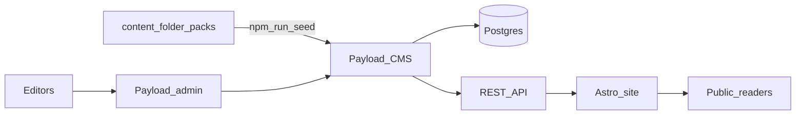

# Architecture

## Apps

| App | Role | Port |
|-----|------|------|
| `@qlu/cms` | Payload 3 on Next.js — admin, REST, uploads | 3000 |
| `@qlu/web` | Astro — soft-paper public UI | 4321 |

Astro talks to Payload over HTTP (`PUBLIC_PAYLOAD_URL`). Dev proxy forwards `/api` and `/media` when useful.

## Collections

| Collection | Purpose |
|------------|---------|
| `users` | Editors (auth) |
| `media` | Uploads |
| `issues` | Monthly magazine (`month`, Te/En titles, `sections[]`) |
| `jnanodayam-readings` | Series + day, Te/En titles + HTML bodies |

Public `read` access requires `published: true` (editors always see drafts).

## Why not Local API in Astro?

Payload Local API must run inside the CMS process. A separate Astro app uses **REST** so CMS and site deploy independently (Hostinger Node / VPS for Payload; static or SSR for Astro).

## Parity with WordPress

| WP | This stack |
|----|------------|
| `qlu_issue` CPT | `issues` |
| `qlu_jnanodayam` CPT | `jnanodayam-readings` |
| Folder seed PHP/Python | `apps/cms/src/scripts/seed.ts` |
| Theme CSS soft-paper | `apps/web/src/styles/qlu.css` |
